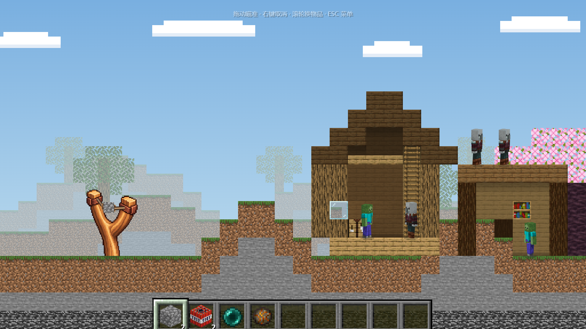

# MC打弹弓 / MC Slingshot

弹弓发射 Minecraft 方块与物品，逐像素破坏固定建筑，清除怪物。**Alpha 0.11.4：主世界十关、唯一昵称、公开计时排行榜与原版背景音乐。**



## 开始游玩

在线试玩：[MC打弹弓](https://qcya.fun:8443/mc-block-launch/)。电脑使用鼠标，安卓手机建议横屏。开局设置昵称，不需要密码；关卡进度保存在当前浏览器，排行榜由服务器共享保存。项目仓库：[qcya/mc-slingshot](https://github.com/qcya/mc-slingshot)。改名保留已有试玩地址、存档键和服务数据目录。

家中同一局域网使用 [192.168.1.4:8770](http://192.168.1.4:8770/)，避免 NAT 回环；内外网使用同一服务端排行榜。浏览器身份和本机关卡进度按访问地址分别保存。

Windows 玩家可下载[0.11.0 历史试玩包](https://github.com/qcya/mc-slingshot/releases/tag/v0.11.0)，完整解压后双击 START_GAME.bat，保留启动窗口。包内自带已校验的 Node.js，不用安装开发工具。不要只提取启动器，也不要直接打开 HTML。离线包使用本机排行榜；与朋友比较成绩请使用上面的在线地址。本轮不生成新的下载包。

源码包含素材和 Matter.js，需要 Node.js 20+ 或 Python 3。双击 START_GAME.bat，或运行 npm start。端口占用自动换端口；复制启动窗口显示的实际地址。Python 静态模式仍可离线玩，排行榜需要 Node 服务。离线通关成绩暂存本机，恢复同一站点的服务后重试上传。

## 操作与闯关

- 拖住弹药调整方向和力度，松开发射；可向后、轻抛。右键取消；手机拉弓时用另一根手指轻点任意位置取消。
- 滚轮或数字键选择物品；手机直接点底部物品栏，触屏保持可见。电脑闲置后自动隐藏，滚轮或移到画面底部唤回。
- ESC / 手机左上角“暂停菜单”暂停；菜单可重开和选关。R 重开当前关。切到其他应用自动暂停。
- 选关“全屏”可请求全屏和横屏；浏览器不支持方向锁定时，手动横过手机。
- 第一、二、三关分别解锁 TNT、末影珍珠、烈焰弹。旧五关全通存档会解锁第六关。
- 清场后等待死亡粒子消散再显示通关；所有弹药和正在进行的攻击结束后才判失败。
- 默认低音量循环 C418《Sweden》，第一次点击后开始播放；暂停菜单可独立开关音乐，偏好自动保存，切后台自动暂停音乐。

| 关卡 | 圆石 | TNT | 珍珠 | 烈焰弹 |
|---|---:|---:|---:|---:|
| 1 村庄小木屋 | 3 | 0 | 0 | 0 |
| 2 石质哨塔 | 3 | 1 | 0 | 0 |
| 3 双层村庄建筑 | 2 | 2 | 1 | 0 |
| 4 掠夺者前哨站 | 2 | 2 | 1 | 1 |
| 5 小型堡垒 | 3 | 3 | 1 | 1 |
| 6 山坡伐木场 | 2 | 2 | 1 | 1 |
| 7 峡谷吊桥 | 2 | 3 | 1 | 1 |
| 8 采石场工坊 | 2 | 4 | 1 | 1 |
| 9 幽深洞窟 | 3 | 3 | 2 | 1 |
| 10 古城最后防线 | 4 | 6 | 2 | 1 |

## 武器与敌人

| 弹药 | 材料效果 | 生物效果 |
|---|---|---|
| 圆石 | 方形刚体，按冲量破坏接触像素；玻璃轻碰即碎 | 普通怪直接击杀，监守者需三枚不同圆石 |
| TNT | 四秒引信；飞行接触仅碎玻璃；爆炸挖去前景和后墙像素 | 无接触伤害；监守者需两次范围内爆炸 |
| 末影珍珠 | 无损穿过一面厚度不超过两完整方块（96px）的墙，出口必须安全 | 飞行命中普通怪直接击杀；监守者需四枚；落稳后无接触伤害 |
| 烈焰弹 | 点燃相连木材，逐像素燃烧；以命中格为中心最宽五格 | 每发三次持续伤害；普通怪三次烧死，监守者六次 |

烈焰弹可烧原木、木板、门、台阶、梯子后墙、工作台、书架，前景和后景都可燃；不烧土、石头、玻璃、熔炉。起点及存在的四邻木块保证燃烧，蔓延受连接和半径限制，不跨空隙。使用原版火焰动画与音效。

**房屋和后墙始终固定，失去支撑也不会倒塌。** 每个初始方块有完整 16×16 纹理，纹理像素可独立破坏。爆炸能推动场上弹药，TNT 各自保留引信。弹药、敌人使用本地 Matter.js 0.20.0，无降级物理模式。

监守者（用户所称坚守者）在第九、十关出现，使用独立大体型碰撞、原版皮肤和立体四肢动画。同一颗圆石反复接触只算一次；爆炸后的落地伤害不会额外扣除其耐久，跌出场景仍算击败。普通怪物会行走、停步观望和抬手，受伤泛红、倒地、白色粒子消散。

## 昵称与排行榜

昵称为 1—16 个汉字、字母或数字，可含空格、下划线、短横线。浏览器保存匿名身份令牌，服务器只保存令牌哈希；改名不会丢失成绩。清除站点数据会失去身份。

新建和改名都由服务器检查昵称是否已被占用，忽略大小写、全角差异及多余空格；冲突显示“用户名已占用”。离线昵称联网后若冲突，需要重新命名。榜上的“星海 · 测试”是按用户要求设置的演示记录，06:37.000，明确标为测试，不能冒充真实玩家提交或修改。

所有玩家都能查看排行榜，最多显示最快的 **100 人**。闯关时只在本机保存各关个人最快用时，**十关全通后才上传成绩并参与排名**。总排名按十关个人最快用时之和升序，不记录耗弹；重玩更快即可刷新。暂停时间不计入用时。旧版完整成绩迁移为计时成绩，旧版未全通记录不参与排行。此榜供朋友试玩，成绩由客户端上报，不具备比赛级防作弊。关卡进度暂不跨设备同步。

## 开发与服务部署

安装开发依赖后执行：

```powershell
npm ci
npm run check
```

测试使用完整 Matter.js 和 Edge / CI Chromium。实际结果与截图见[测试记录](docs/TEST_RESULTS.md)，素材见[LICENSES](LICENSES.md)和[战斗素材](docs/combat-assets.md)，修改见[CHANGELOG](CHANGELOG.md)。两个素材来源仓库保持只读。

Toy 官方技能已安装并阅读，发布前检查与当前平台接入边界见 [Toy 说明](docs/TOY.md)。

Node 服务默认绑定 127.0.0.1:8766，可设置 HOST、PORT、MC_DATA_DIR。排行榜目录必须在游戏目录之外，每个数据目录只能运行一个进程，重启保留成绩。公网通过反向代理部署，见[部署说明](docs/DEPLOYMENT.md)。不要把连接凭据、成绩文件或开发依赖放进公开目录。

当前边界：只有主世界十关，地狱、末地尚未制作。人物外观立体，物理仍为二维；不会沿梯子寻路。安卓已做触控与布局检查，真实手机性能与公网连通仍需朋友试玩反馈。旧版 iOS 暂缓。瞄准五点仅显示前半秒自由飞行趋势，不预测碰撞反弹。
