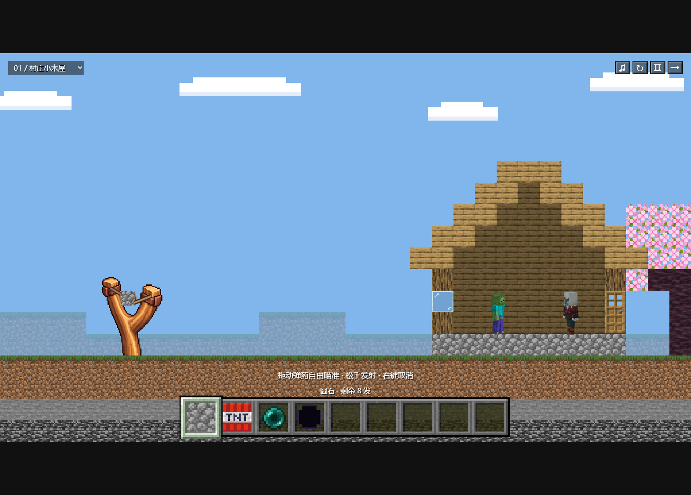

# MC方块弹射 / MC Block Launch

用弹弓发射圆石、TNT、末影珍珠或黑洞，逐像素破坏 Minecraft 风格建筑并消灭怪物。**Alpha 0.7.1**。素材和 Matter.js 均随项目提供，游戏运行无需联网。



## Windows 开始游戏

解压完整源码，双击 **START_GAME.bat**。需要安装 **Node.js 20+ 或 Python 3**；启动脚本自动选择可用环境并打开浏览器。保留服务窗口，关闭它即可停止服务。推荐桌面版 Edge / Chrome。

也可在项目文件夹执行 `npm start`，打开 `http://127.0.0.1:8766/`。只玩游戏无需 `npm install`。不要直接双击 HTML；端口被旧服务占用时先关闭旧窗口。

- 拖住弹药自由瞄准，松开发射，可向后或向下射，小力度也能发射。右键取消拉弓，不消耗弹药。拉动时有皮筋声音。
- 滚轮或 `1–9` 切换九格物品栏，前四格为弹药，其余为空格。所有弹药共用剩余发数。
- `R` 重开、`N` 下一关、空格暂停；左上角可直接选关。
- 清除全部怪物获胜；弹药用尽且攻击效果结束后判定失败。

## 关卡与弹药

五关依次为村庄小木屋、石质哨塔、双层村庄建筑、掠夺者前哨站、小型堡垒，分别有 8、8、9、9、10 发弹药。

| 弹药 | 效果 |
|---|---|
| 圆石 | 方形刚体，局部撞击破坏、反弹、翻滚并逐渐停稳；接触玻璃即打碎整片玻璃方块，可连续穿过多片 |
| TNT | 发射点燃四秒引信，从开始闪白并逐渐加快；碰撞只打碎玻璃，爆炸破坏前后景像素，并炸飞附近圆石与其他 TNT，后者保持自己的引信 |
| 末影珍珠 | 测量实际墙厚并寻找安全出口，最多穿墙一次，上限 64 画面像素；厚墙或出口不足时阻挡 |
| 黑洞 | 吸附首次接触的实体，持续 4.2 秒吸引物体与怪物，限量吞噬前后景像素 |

圆石、珍珠、TNT 直接碰到怪物即击杀。怪物使用原版皮肤贴在头、躯干、双臂、双腿的立体模型上，连续行走，会停步观望、转头和抬手；怪物之间可以交错走过。

## 本版破坏规则

**按最新反馈，房屋及后墙固定，失去支撑也不会坍塌。** TNT、黑洞和撞击留下的缺口会保留，不会生成新的完整方块。后墙没有碰撞，但可被爆炸和黑洞破坏。地下保留暗色远层，挖掉近处泥土后不会直接露出天空。

初始材料为完整 16×16 纹理方块，每个纹理像素独立记录材质和耐久；整数放大显示。静态碰撞形状随剩余像素更新。弹药和敌人使用同一个 **Matter.js 0.20.0** 世界，没有物理降级模式。爆炸碎屑飞散后淡出。

弹弓木架使用用户提供的透明 PNG，皮筋、弹药兜单独绘制和回弹。[素材来源](assets/sprites/slingshot-frame.source.md)随项目保存。弹弓向右移动，末端埋入土中并遮挡。场景仅右侧一棵樱花树，装饰树不参与碰撞，云保持静态；轨迹使用同一物理引擎，只显示短半程。

## 测试与开发

```powershell
npm ci
npm run check
```

本机浏览器测试使用 Edge，CI 使用 Playwright Chromium。实际结果、截图和五关攻击回放见[测试记录](docs/TEST_RESULTS.md)，修改见[CHANGELOG](CHANGELOG.md)，素材来源见[LICENSES](LICENSES.md)。两个素材来源仓库保持只读。

当前边界：人物具有立体外观，碰撞和关卡仍为二维；尚无敌人主动攻击或复杂寻路。预测线不预演未来移动的怪物。面向桌面鼠标，手机竖屏未专门优化。本阶段没有视频渲染器、创意工坊或 AI 地图生成。
