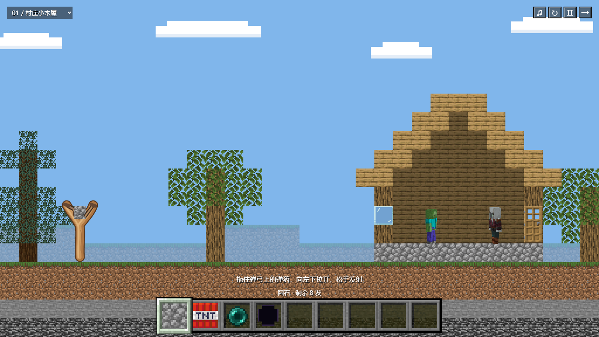
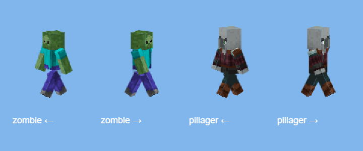

# MC方块弹射 / MC Block Launch

Minecraft 视觉风格的二维物理攻城游戏。用弹弓发射圆石、TNT、末影珍珠或黑洞，破坏房屋支撑、击倒结构并消灭怪物。**Alpha 0.6**，游戏素材与 Matter.js 均在本地，无需联网加载。



## Windows 开始游戏

下载并解压完整源码，双击 **`START_GAME.bat`**。需要电脑已安装 **Node.js 20+** 或 **Python 3**，启动脚本会选择可用的运行环境并打开浏览器。保留服务窗口，关闭它即停止游戏服务。推荐桌面版 Edge / Chrome。

也可以在项目文件夹执行 `npm start`，然后打开 `http://127.0.0.1:8766/`。仅玩游戏**不需要 npm install**。不要直接双击 HTML：浏览器会限制本地 ES 模块和音频读取。端口已被旧服务占用时先关闭旧窗口。

- 拖住弹弓弹药，向左或左下拉动，松开发射；拖拽长度决定力度。弹药从实际拉开的位置起飞，皮筋随即回弹。
- 滚轮或 `1–9` 切换九格物品栏；前四格为弹药，其余为空格。空格不会发射。剩余发数为四种弹药共用。
- `R` 重开、`N` 下一关、空格暂停；左上角可以选择任意关卡。
- 清除全部怪物获胜，弹药用完并且攻击效果结束后判定失败。

## 已有内容

| 关卡 | 结构 | 发数 |
|---|---|---:|
| 村庄小木屋 | 木柱、玻璃、木门与山墙屋顶 | 8 |
| 石质哨塔 | 石柱、木楼板、垛口 | 8 |
| 双层村庄建筑 | 双层木楼板与屋顶 | 9 |
| 掠夺者前哨站 | 高架木楼、外挑平台、承重柱 | 9 |
| 小型堡垒 | 双塔、厚石墙与门楼 | 10 |

| 弹药 | 效果 |
|---|---|
| 圆石 | 方形刚体，局部接触破坏、反弹、翻滚，落地后可睡眠停稳；普通撞击不删除后墙 |
| TNT | 方形刚体，发射时点燃 **4 秒引信**，从点燃起闪白并逐渐加速；碰撞只打碎玻璃，爆炸才挖掉其他材料与后墙像素，并施加冲击力 |
| 末影珍珠 | 依据实际墙厚寻找安全出口，最多穿越一次、墙厚上限 64 画面像素；厚墙或无完整出口时阻挡 |
| 黑洞 | 黏附首次接触的实体表面，持续 4.2 秒吸引刚体并逐步吞噬前后景，限制每次吞噬数量与粒子上限 |

圆石、珍珠、TNT **直接碰怪即击杀**。小碎片与建筑残骸按接触点速度和质量判伤，包含旋转梁端的速度。人物使用原版僵尸和掠夺者皮肤，分别贴在头、躯干和四肢立方体上，以侧面正交投影显示；步态按连续相位逐帧绘制，会巡逻、相遇转身、在墙边和边缘转向，楼板消失时自然下落，进入黑洞范围时停止巡逻控制并服从吸力。



## 破坏与物理

初始材料为完整 **16×16** 纹理方块，每个纹理像素独立记录材质与耐久，按 3 倍显示，每方块占 48×48 画面像素。损坏后依据剩余像素生成准确的矩形复合碰撞形状，保留孔洞；脱离支撑或支撑范围不再覆盖重心的结构交给 **Matter.js 0.20.0** 平移、旋转、碰撞和再次破坏。没有物理降级路径。

按最新反馈，发射器已由投石车换成弹弓。弹弓采用干净的圆润木架、皮筋与皮质弹药兜，单独使用 Canvas 绘制，不套用 MC 方块材质。场景和弹药继续使用原版贴图。

房屋后墙没有碰撞，但有自己的材质像素，TNT 与黑洞能破坏它；后墙跟随实际楼板或屋顶残骸。地下保留暗色远层材质，挖掉近处泥土后不会直接露出天空。装饰树与远景不参与承重；云保持静态。轨迹采用相同 Matter 固定步长与空气阻力，只显示首次遮挡前的半程，并随残骸位置更新。

## 测试

安装开发依赖后执行：

```powershell
npm ci
npm run check
```

本机浏览器测试使用已安装的 Edge；CI 使用 Playwright Chromium。测试结果、截图及可复现的五关攻击序列见 [测试记录](docs/TEST_RESULTS.md)。测试包含正常 Matter 模式、资源加载失败提示、实际鼠标拖拽、圆石停稳、四种弹药、五关前后画面、人物巡逻、半程轨迹、薄厚墙与楼板后墙联动。

## 当前边界

- 结构断裂采用像素连通性与承重截面重心判断，属于物理游戏近似；细长悬臂的弯曲应力没有单独模拟。
- 人物当前只巡逻和受击，没有寻路、射击或其他主动攻击 AI；立体外观与二维碰撞体分工。
- 轨迹用于辅助瞄准，只展示短半程；后续会移动的敌人和残骸仍可能改变落点。
- 当前面向桌面鼠标操作，手机竖屏与大量自制复杂结构尚未专门优化。

源码模块在 `src/`，开发测试在 `tests/`，素材来源见 [LICENSES.md](LICENSES.md)，修改记录见 [CHANGELOG.md](CHANGELOG.md)。两个素材源仓库仅作只读复用。本阶段没有视频渲染器、创意工坊或 AI 地图生成。
