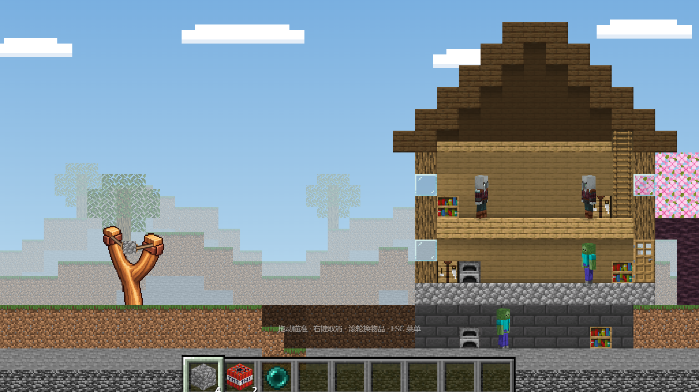

# MC方块弹射 / MC Block Launch

用弹弓发射 Minecraft 方块与物品，逐像素破坏建筑，清除怪物。**Alpha 0.10.0**，五关闯关模式，仅有圆石、TNT、末影珍珠。



## Windows 启动

解压完整源码，双击 **START_GAME.bat**。电脑需要 **Node.js 20+ 或 Python 3**；游戏素材和 Matter.js 均已附带，玩游戏无需安装 npm 依赖或联网。保留服务窗口。端口被占用时自动换空闲端口，使用启动器打开的实际网址。

也可执行 `npm start`。不要直接双击 HTML。

## 闯关与操作

新存档只开放第一关。第一关通关解锁 TNT，第二关通关解锁末影珍珠；第三关起使用这三种物品组合，不再增加新物品。进度保存在本机浏览器中。

| 关卡 | 圆石 | TNT | 珍珠 |
|---|---:|---:|---:|
| 村庄小木屋 | 5 | 0 | 0 |
| 石质哨塔 | 4 | 1 | 0 |
| 双层村庄建筑 | 4 | 2 | 1 |
| 掠夺者前哨站 | 4 | 2 | 2 |
| 小型堡垒 | 5 | 3 | 3 |

- 拖住弹药自由瞄准，松开发射。支持向后、小力度发射；右键取消，不消耗物品。
- 滚轮或数字键换物品。各物品分别计数；物品栏闲置自动下滑，滚轮、数字键或鼠标移至屏幕底部可唤回。
- **ESC** 打开暂停菜单，可继续、重新挑战、选关和切换音效；`R` 重开本关。
- 使用原版弩上弦音效和发射音效。弹药兜跟随方向旋转；瞄准始终为八个点。
- 击杀全部怪物获胜，显示解锁奖励。耗尽所有物品且攻击结束后失败，重新挑战恢复本关库存。

## 破坏规则

三种发射弹药统一为 28 像素，珍珠放大、圆石与 TNT 缩小；碰撞尺寸随外观更新。圆石和 TNT 为方形刚体，可以反弹、翻滚、落地停稳。

| 弹药 | 接触方块 | 接触怪物 |
|---|---|---|
| 圆石 | 物理冲量破坏，接触玻璃即碎，可连续穿过多片 | 直接命中击杀 |
| TNT | 接触仅碎玻璃，其余材料等爆炸破坏 | 接触无伤害，爆炸造成伤害 |
| 末影珍珠 | 无损穿过一面薄墙；厚墙或再次碰墙均不破坏材料 | 直接命中击杀 |

TNT 发射后使用四秒引信，从开始闪白并逐渐加快。爆炸破坏具体像素，同时炸飞附近 TNT 与落地圆石，其他 TNT 保持自己的引信。珍珠测量真实墙厚并寻找安全出口，最多穿墙一次，墙厚上限 64 画面像素。石材比木材更硬。

**建筑和后墙固定，不发生坍塌。** 每个初始前景方块为完整 16×16 原版纹理，每个纹理像素独立破坏，碰撞随缺口更新。后墙、家具、阁楼和梯子没有碰撞，但可以被 TNT 炸掉。弹药及敌人统一使用本地 Matter.js 0.20.0，无降级模式。

人物使用原版皮肤的立体头身与四肢，会行走、停步观望、抬手，可以相互交错走过。受伤短暂泛红，死亡倒地后化为白色粒子，消散完成再显示过关菜单。后续关卡包含完整方块组成的台阶山坡、凹地，第三关有开放入口的地窖和地下守卫。

选关使用泥土纹理背景和原版灰色按钮，暂停与奖励使用同一按钮样式。远景使用原版草、泥土、石头和树木纹理，方云缓慢移动。弹弓使用用户提供的透明 PNG，末端藏在土中。

## 开发与测试

```powershell
npm ci
npm run check
```

本机使用 Edge，CI 使用 Playwright Chromium。实测结果和截图见 [测试记录](docs/TEST_RESULTS.md)，改动见 [CHANGELOG](CHANGELOG.md)，素材见 [LICENSES](LICENSES.md)。素材来源仓库保持只读。

边界：人物有立体外观，物理仍为二维；尚无复杂寻路和敌人主动攻击。梯子、家具和阁楼位于可破坏后景，角色不会沿梯子爬行。瞄准点显示自由飞行趋势，不提前模拟撞击后的反弹。存档随浏览器站点数据保存，更换端口或浏览器会使用独立存档。
